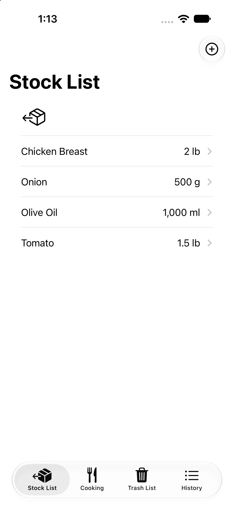
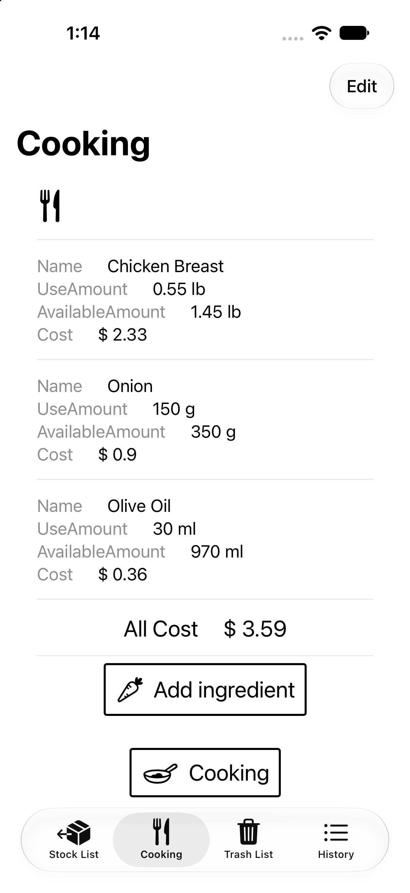

# Costo

購入した食材の在庫量と、調理に使った分の原価(コスト)・履歴を管理する SwiftUI + SwiftData アプリです。
※ 海外の友人からの要望で作成したため、画面表記は英語、通貨はドル(`$`)、重量単位はポンド(`lb`)・グラム(`g`)・ミリリットル(`ml`)に対応しています。

## スクリーンショット
| Stock List | Cooking |
| :---: | :---: |
|  |  |

## 主な機能
- **Stock List / Trash List**：食材の登録・編集・ゴミ箱移動・完全削除
- **Cooking**：使用する食材と量の選択、調理時の原価計算と在庫の自動減算
  - ポンド(`lb`)で登録した食材をグラム(`g`)単位で使用する際の自動換算に対応
- **History**：調理ごとの使用食材と合計コストの履歴表示

## 構成
- **UI / 状態管理**：SwiftUI + `@Observable`(Observation)
  - ビジネスロジックや入力検証を持つ画面に `@Observable` の ViewModel を配置し、シート表示などの単純な UI 状態は View の `@State` で管理しています
- **データ永続化**：SwiftData(`@Model` / `@Query` / `@Relationship`)
  - Preview 用には `isStoredInMemoryOnly: true` のインメモリ `ModelContainer` を使用しています
- **テスト**：`CostoTests` で原価計算・単位換算(`lb` → `g`)・入力制限のテストを実装しています

## 今後の展望(次期アプリ構想：FridgeStock)
本アプリで「食材の登録」と「使用時の在庫減算」を実装したことで、実際の利用における次の課題と拡張アイデアが見えています。
- **課題**：冷蔵庫に入れた食材を忘れてしまう／毎回手動で使用量を入力して減らす手間がある
- **次の構想(FridgeStock)**：
  - 登録されている在庫食材から作れるメニュー(レシピ)の提案機能
  - 調理したメニューを選ぶだけで、使用した食材の在庫をまとめて減算する仕組み

## 動作環境
- Xcode 27.2 / iOS 17.4 以上